# Introduction {#sec:intro}

This report studies how the design of a parallel matrix multiplication program affects its speed. It asks three questions. First, how does the loop order, which decides how data moves through the cache, change the speed of the multiplication, and why? Second, how much do extra threads help, and can adding threads keep making the program faster without limit? Third, how does the system reserve stack memory and RAM, and is the reserved amount the same as the amount used?

# Test environment {#sec:env}

The experiments ran on a personal computer (AMD Ryzen 9 8945HX, 16 cores and 32 threads on 2 CCDs) with 30 GB of memory, running Ubuntu 26.04.1 LTS, with the CPU governor set to performance and the charger plugged in for the whole experiment [@amd8945hx].

\needspace{25\baselineskip}

| Item           | Value                                                                                            |
| -------------- | ------------------------------------------------------------------------------------------------ |
| CPU            | AMD Ryzen 9 8945HX, 16 cores / 32 threads, 2 CCDs                                                |
| Cache          | L1d 32 KB per core, L2 1 MB per core, L3 32 MB per CCD (64 MB total)                             |
| RAM            | 30 GB                                                                                            |
| OS / kernel    | Ubuntu 26.04.1 LTS, Linux 7.0.0-38-generic                                                       |
| Compiler       | gcc 15.2.0 (`-O3 -march=native -fopenmp`), OpenMP runtime libgomp                                |
| glibc / Python | 2.43 / 3.14.4                                                                                    |
| Settings       | governor performance, boost on, power profile performance, on AC power, `ulimit -s` = 8192 KB    |
| CPU layout     | CPUs 0-15 are physical cores 0-15, CPUs 16-31 their SMT siblings; cores 0-7 on CCD0, 8-15 on CCD1 |

: {#tab:env}

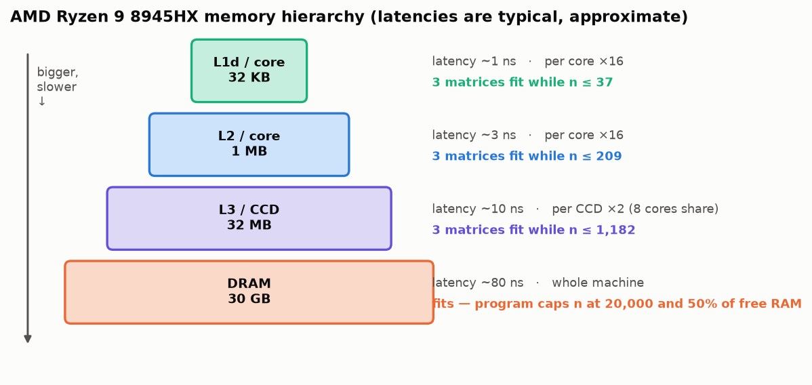{#fig:cache width=90%}

# Algorithms and program design {#sec:design}

## Storing a matrix in memory {#sec:rowmajor}

Memory is a one-dimensional list, so the program stores each matrix row by row. The element in row y and column x of a matrix of width n sits at index y*n+x. The cache loads this array in lines of 64 B [@silberschatz2018].

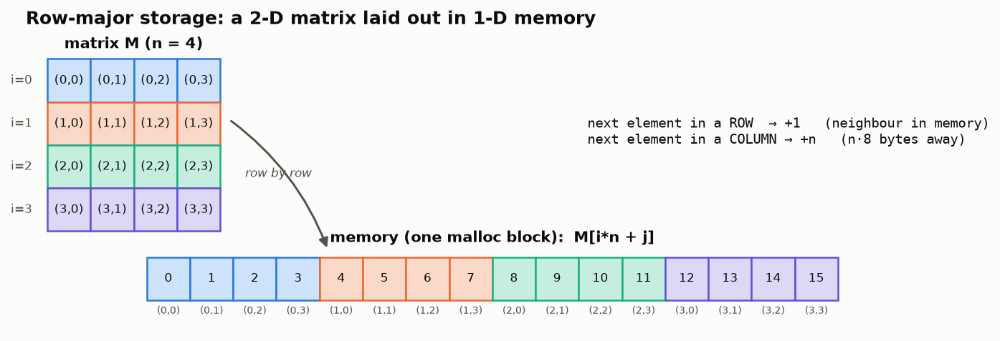{#fig:rowmajor width=95%}

## Three algorithms {#sec:algos}

Each element of the product is one row times one column, which takes 2n operations, so all n^2 elements take 2*n^3. The experiment compares three algorithms that do the same arithmetic in a different memory order. ijk walks down the columns of a matrix, but the matrix is stored by rows, so every step to the next row lands on a different cache line. ikj walks along rows, which matches the storage order and needs far fewer new cache lines. blocked splits the matrices into equal square tiles (four in the illustration), multiplies them tile by tile while sliding over the tiles until each part of the result is complete, and assembles the parts into the product [@lam1991; @goto2008].

{#fig:cachesim width=95%}

{#fig:blocked width=95%}

## Parallelising with OpenMP {#sec:openmp}

Splitting the work element by element, as in the picture, could cause race conditions, so the program splits it by rows and gives each thread its own rows. OpenMP offers two ways to do this: static assigns fixed rows to each thread at the start, and dynamic hands out rows on demand as threads finish. The program uses static because it has less overhead than dynamic, which has to track and assign rows while the threads run [@openmp52; @libgomp].

{#fig:omp width=90%}

## Phases and timing {#sec:phases}

Timing is split into three phases: init runs serially; multiply runs in parallel and is repeated several times, with the median reported so the value is reliable; verify runs serially.

## System safety (do no harm) {#sec:safety1}

The program caps the matrix size at n <= 20000 and the thread count below the number of CPUs, checks before allocating that it needs no more than half of MemAvailable, never runs as root, and records the OS settings shown here so the experiment can be repeated. The guards were tested and refuse the cases they are meant to refuse.

\needspace{23\baselineskip}

# Method {#sec:method}

| Set      | Independent variables                                                                     | Runs |
| -------- | ----------------------------------------------------------------------------------------- | ---- |
| scaling  | threads {1,2,4,8,12,16,24,32} × n {100-3200} × {ijk, ikj, blocked} (+ n=6400 blocked)     | 152  |
| block    | tile b = 8…512                                                                            | 40   |
| schedule | 7 `OMP_SCHEDULE` settings                                                                 | 84   |
| compiler | `-O0 … -O3 -march=native`                                                                 | 30   |
| os       | affinity, taskset (SMT/CCD), `OMP_STACKSIZE`, a competing process, power profile          | 57   |

: {#tab:experiments}

Table 2 lists the independent variables, grouped into five sets. Each set varies its own variables and holds the others fixed; the machine, the random seed and the conditions in Table 1 are fixed throughout. Every configuration was measured 5 times and the median is reported, because in this experiment the median reflects typical behaviour better than other averages. The dependent variables are the time of each of the three phases, GFLOP/s, peak RSS, VmPeak and temperature.

# Results and analysis {#sec:results}

## Thread count {#sec:threads}

Figure 7 shows the speed rising steeply as threads are added up to about 15, and the curve flattening clearly past 16 threads. This matches Amdahl's law: adding threads to the parallel part cannot speed up the whole program without limit, because at some point the serial work dominates the total time, as in Speedup = 1/(s + (1−s)/p) [@amdahl1967]. The Amdahl section below measures how much the serial part matters.

\needspace{17\baselineskip}

| n | ijk S(16) / S(32) | ikj S(16) / S(32) | blocked S(16) / S(32) | blocked E(16) |
|---|---|---|---|---|
| 100 | 3.55 / **0.09** | 1.47 / 1.27 | 1.07 / 1.19 | 0.07 |
| 800 | 11.07 / 9.33 | 4.26 / 4.24 | 7.00 / 7.85 | 0.44 |
| 3200 | 10.19 / 12.23 | 8.59 / 12.86 | 9.56 / 12.03 | 0.60 |
| 6400 | n/a | n/a | 11.54 / **13.47** | 0.72 |

: {#tab:threads}

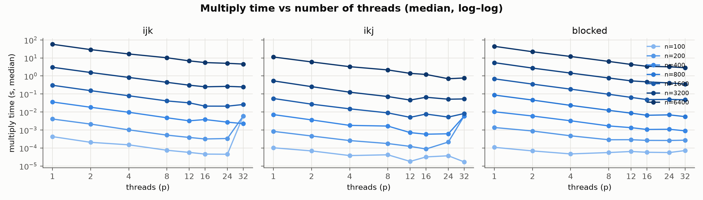{#fig:time width=100%}

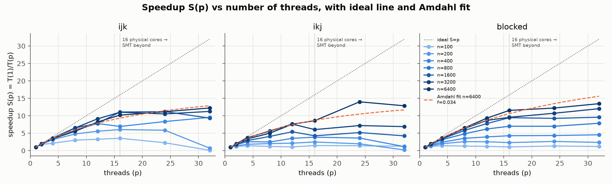{#fig:speedup width=100%}

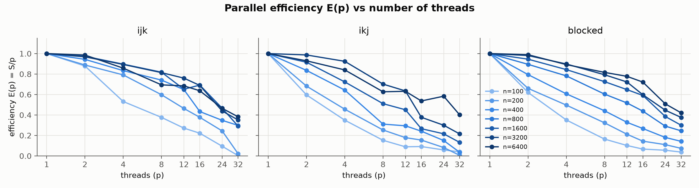{#fig:efficiency width=100%}

## Matrix size {#sec:size}

The GFLOP/s measurements show the three access patterns running at different speeds. With one thread the gap is small, and it widens as threads are added (the figure shows 16 threads). ijk is the slowest, because its access pattern wastes memory traffic and does not match the row-major layout. The more interesting pair is ikj and blocked: ikj is faster for matrices smaller than 800 and slower beyond that. A likely reason is that a larger matrix pushes accesses deeper into the memory hierarchy. A row that used to fit in one level of cache no longer does, so the row-wise pattern has to go to memory several times to finish its work. blocked holds up better: it already reuses each tile many times and replaces cache contents less often, so its speed does not drop like the others [@lam1991].

\needspace{15\baselineskip}

| GFLOP/s, 1 thread | n=100 | n=400 | n=800 | n=1600 | n=3200 | n=6400 |
|---|---|---|---|---|---|---|
| ijk | 4.7 | 3.6 | 3.4 | 2.7 | **1.1** | n/a |
| ikj | 19.4 | 17.9 | 18.3 | 15.4 | **5.8** | n/a |
| blocked | 18.3 | 12.5 | 11.8 | 11.8 | 12.0 | 11.9 |

: {#tab:gflops}

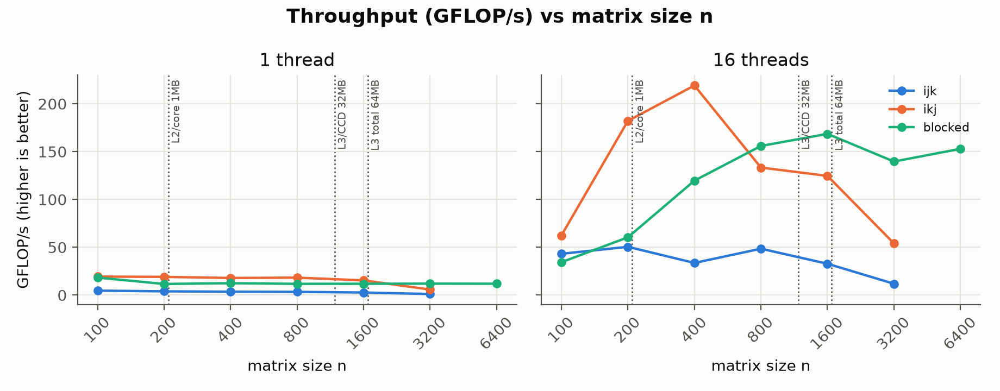{#fig:gflops width=100%}

## Program settings {#sec:progsettings}

These experiments fix the access method to blocked.

Varying the tile size (Figure 10) shows that a tile of 8 is the worst and 192-256 is the best. Tiles that are too small have to be moved many more times before the full product is complete.

For the OpenMP schedule, at small n (n=400) the GF/s of the different settings scatter with no consistent order. For example, n=400 blocked with (static, guided),16 reaches 30 GF/s, while the other settings at the same n are above about 100 GF/s. At n=3200 the settings cluster together and keep the same order. The schedule setting therefore matters less as n grows.

\needspace{17\baselineskip}

| Comparison                 | Time   |
| -------------------------- | ------ |
| n=3200 ijk, 16 threads     | 5.53 s |
| n=3200 blocked, 1 thread   | 5.47 s |
| n=3200 ijk, 32 threads     | 4.58 s |
| n=3200 blocked, 32 threads | 0.35 s |

: {#tab:compare}

At n=3200, ijk with 16 threads takes 5.53 s and blocked with one thread takes 5.47 s. The memory access pattern matters more than the thread count: ijk on 16 threads is slower than blocked on one.

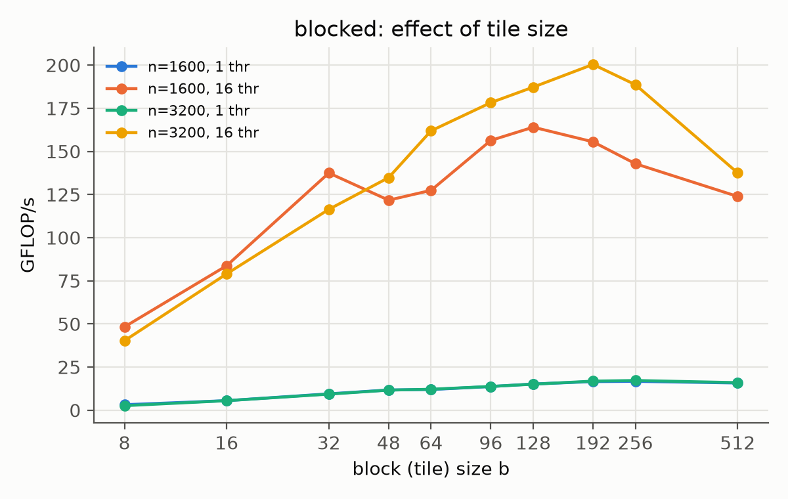{#fig:block width=75%}

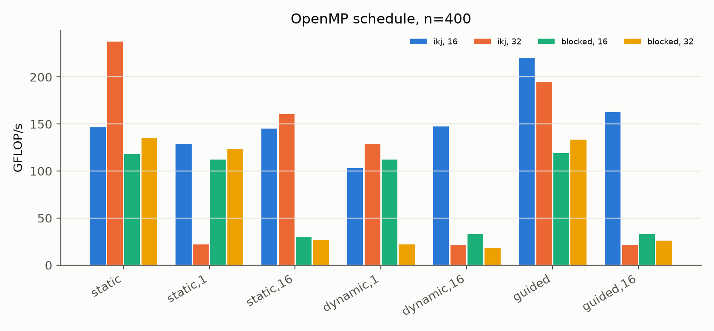{#fig:sched400 width=80%}

{#fig:sched3200 width=80%}

## Operating system settings {#sec:ossettings}

Comparing physical cores with SMT (Figures 13-14), 16 cores are clearly faster than 8 cores with SMT, because two SMT threads compete for the resources of the core they share. Letting the OS scheduler place the threads also beats pinning them to fixed CPUs.

ikj on 2 CCDs reaches 33.9 GF/s, faster than the 28.9 GF/s on one CCD, because the second L3 relieves the memory bandwidth bottleneck by more than the cross-CCD overhead costs.

A competing process cuts performance almost in half (Figure 15), most likely because of the context switches the OS has to make between the two [@silberschatz2018].

The power profile changes the speed, most likely because the OS lowers the clock frequency in the slower modes.

The runs were made with a browser and VS Code open in the background, so the results may be affected by them and are not absolute values.

\needspace{21\baselineskip}

| Experiment (n=3200) | GFLOP/s |
|---|---|
| taskset 16 thr: **16 physical cores** vs **8 cores × 2 SMT** | blocked **140.5 vs 98.9**; ikj 54.2 vs 45.0 |
| `OMP_PLACES=threads` + `close` (16 thr) | blocked **100.7** (≈ 8 cores × SMT, 98.9) vs default 137.7 |
| ikj 16 → 32 thr (static) | 54.7 → **88.8** |
| 1 CCD (8 cores) vs 2 CCDs (4+4) | blocked 74.6 vs 74.1; ikj 28.9 vs **33.9** |
| a competing 16-thread process | 32 thr: **181.4 → 93.7**; 16 thr: 120.9 → 93.6 |
| power profile performance / balanced / power-saver | blocked 1 thr: 11.9 / 11.9 / **5.9**; 16 thr: 156 / 140 / **86** |

: {#tab:os}

{#fig:taskset width=75%}

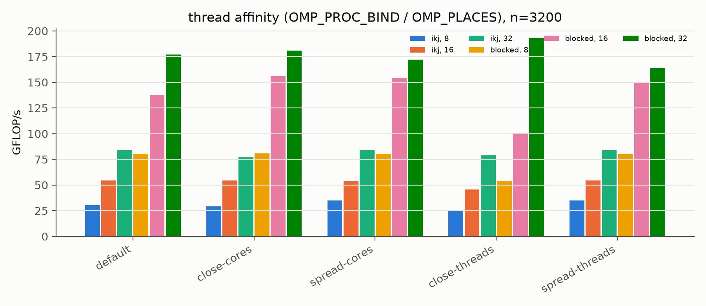{#fig:bind width=85%}

{#fig:contention width=65%}

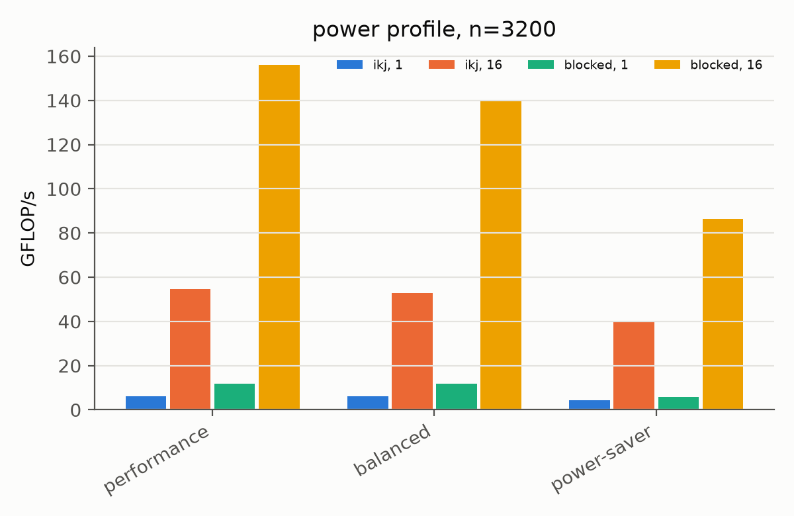{#fig:power width=75%}

## Memory use {#sec:memory}

Physical memory use matches the theory (3n² × 8 B). For example, n=3200 should take 234.4 MiB and measured 235.9 MiB, and n=6400 should take 937.5 MiB and measured 939.5 MiB.

VmPeak grows with the thread count while RSS stays flat. At n=1600, going from 1 to 32 threads raises VmPeak from 62 to 310 MiB, while RSS stays near 61 MiB.

Setting the thread stack size to 1M, 8M and 64M changes VmPeak to 93, 310 and 2046 MiB, while RSS stays near 61 MiB and the speed does not change.

Demand paging explains both results: the OS reserves virtual memory first and backs it with real RAM only when a page is touched [@silberschatz2018].

{#fig:memn width=65%}

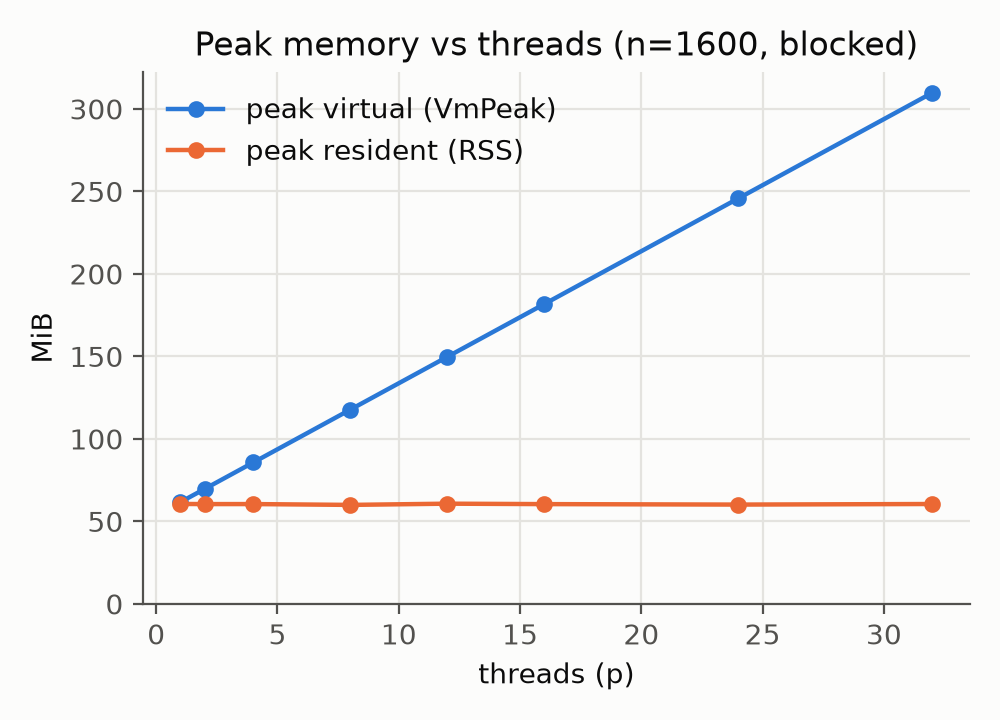{#fig:memthreads width=65%}

## Amdahl's law: serial and parallel fractions {#sec:amdahl}

Fitting S(p) = 1/(s + (1−s)/p) [@amdahl1967] by least squares gives the serial fraction $f_\text{fit}$ and, from it, the speedup ceiling. Table 7 and Figures 19-20 show the results.

At small n, $f_\text{fit}$ and $f_\text{meas}$ are close. At larger n they part: blocked at n=6400 gives $f_\text{fit}$ = 0.029, a ceiling of 35×, while $f_\text{meas}$ is 0.010. The gap probably comes from overhead such as SMT, temperature or memory.

The Karp–Flatt metric e(p) makes the overhead clearer. It is not constant and grows with p, so the more threads, the larger the cost of running in parallel [@karp1990].

\needspace{23\baselineskip}

| algo | n | $f_\text{fit}$ (p ≤ 16) | $f_\text{meas}$ | $S_\text{max}$ (p) | $1/f$ | R² |
|---|---|---|---|---|---|---|
| ijk | 100 | 0.240 | 0.232 | 3.6 (16) | 4.2 | n/a |
| ijk | 3200 | 0.046 | 0.002 | 12.2 (32) | 22 | 0.98 |
| ikj | 3200 | 0.065 | 0.010 | 14.0 (24) | 15 | 0.89 |
| blocked | 200 | 0.358 | 0.259 | 2.6 (24) | 2.8 | 0.81 |
| blocked | 1600 | 0.052 | 0.038 | 9.6 (32) | 19 | 0.92 |
| blocked | 3200 | 0.038 | 0.020 | 12.0 (32) | 27 | 0.94 |
| blocked | 6400 | 0.029 | 0.010 | 13.5 (32) | 35 | 0.94 |

: {#tab:amdahl}

{#fig:amdahlfit width=100%}

{#fig:karpflatt width=100%}

## Limits of the experiment {#sec:limits}

The runs kept the CPU under heavy load, and at times it reached 98-100 °C, which made the system lower the clock frequency to protect the hardware.

Other programs were open in the background and may have competed for the CPU or memory at times.

For small matrices the computation is so short that overhead noise has a large effect on the results.

# Memory map tool {#sec:mmap}

## Idea and data source {#sec:proc}

The tool reads the /proc file system, the interface Linux uses to expose the state of each process. A VMA (virtual memory area) is a contiguous block of virtual memory with one set of access permissions. Each line of `/proc/<pid>/maps` describes one VMA: its address range, its permissions (rwxp) and the mapped file. `/proc/<pid>/smaps` and the other files give further state, the process limits and a link to the running executable [@kernelproc; @man_proc_pid_maps; @man_proc_pid_smaps].

Reading the state straight from the OS shows the memory of a running program in real time, makes demand paging visible, and costs less overhead than other methods.

## Design and implementation {#sec:mmapdesign}

The tool works in five steps: read the live state from the system, parse the VMAs, classify them, merge blocks of the same kind, and draw the result.

Classification is a decision tree:

1. Check the path and classify heap, stack and kernel regions from it.
2. If the region has no name, decide from its permissions and flags.
3. If a file is mapped, check whether it is the running executable (`program code/data`); if not, whether it is a `.so` (`library code/data`). Every other file falls into the general `mapped file` category.

\needspace{27\baselineskip}

## Features and usage {#sec:mmapusage}

| Command | Output |
|---|---|
| `python3 mmap.py PID` | snapshot: summary + address-space layout |
| `python3 mmap.py PID --all` | also list every region (no merging of segments) |
| `python3 mmap.py PID --watch` | real-time view, refresh every `--interval` seconds |
| `python3 mmap.py PID --html out.html` | write a self-contained HTML/SVG report |
| `python3 mmap.py --run -- CMD [ARGS...]` | start CMD, watch it until it exits, then report |
| `python3 mmap.py --self` | inspect this Python process itself (demo) |
| `python3 mmap.py --list` | list your own processes |

: {#tab:mmapcmd}

Table 8 lists the commands; each runs the memory analysis in the chosen mode.

Figures 21 and 22 are real screenshots of the terminal view and the HTML report. Solid marks show RSS, faded marks show memory that is reserved but not yet used, and vertical dots show gaps in the address space.

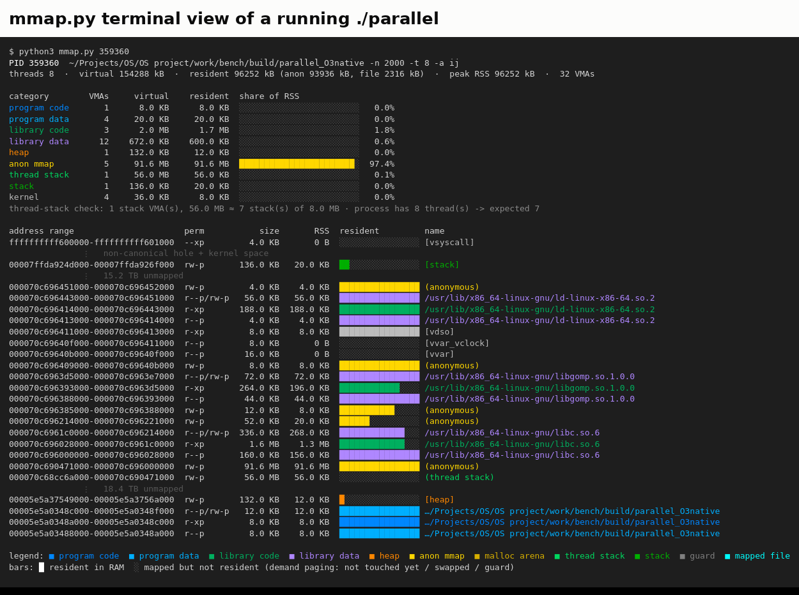{#fig:terminal width=100%}

{#fig:html width=80%}

## Watching the program from part 1 {#sec:mmapdemo}

Watching the matrix multiplication program from part 1 shows how it behaves. The OS first loads the executable and the C library into memory. When the program allocates the matrices, anonymous mmap grows, thread stacks appear during the parallel phase, and everything is returned when the program ends. During the parallel phase the thread stacks reserve 56 MB in total but hold only 56 KB of real RSS, which is most likely demand paging [@silberschatz2018].

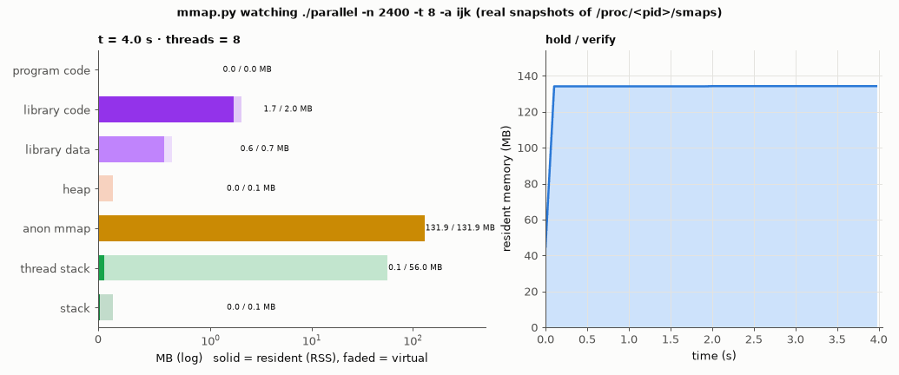{#fig:mmaprun width=100%}

## Safety and limits {#sec:safety2}

The tool only reads. It needs no root rights and does not interfere with any process, so it can inspect only the processes the user owns. It works only on Linux, because it depends on /proc.

# Conclusion {#sec:conclusion}

The experiments show that the memory access pattern matters more for performance than adding threads alone. The Amdahl fit gives a serial fraction of about 0.03-0.05; part of that is parallel overhead, so it is not purely serial work. The memory map tool can follow a program's memory while it runs.

# Use of AI {#sec:ai}

The project used an AI coding assistant in VS Code as its main AI tool. It helped with code (the multiplication program, all of `mmap.py`, `run_bench.py`, `analyze.py`, `check_submission.py` (a pre-submission check script that is not in this repo), the PDF build, and an outline with numbers and a checklist) and answered the author's questions. For the report, the tool only checked facts and organised the outline; the author wrote the text.

The author checked the tool's output by recomputing the results by hand and comparing them with theory.
