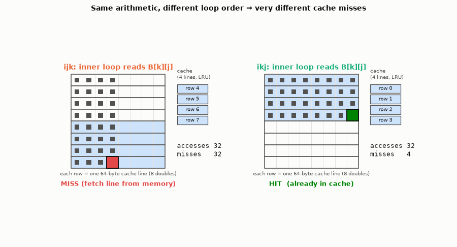
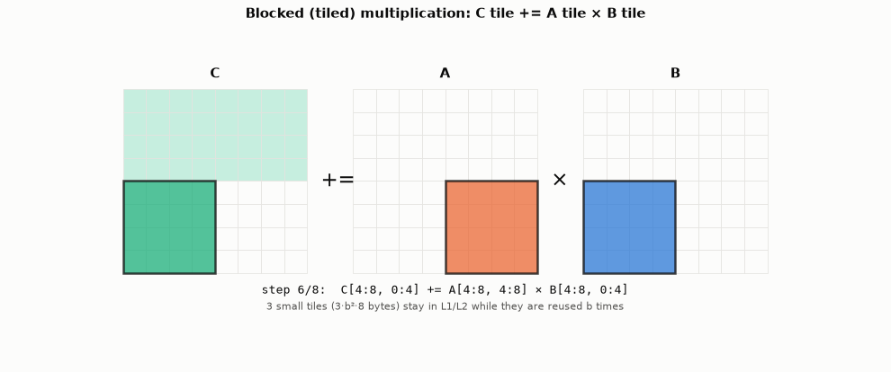
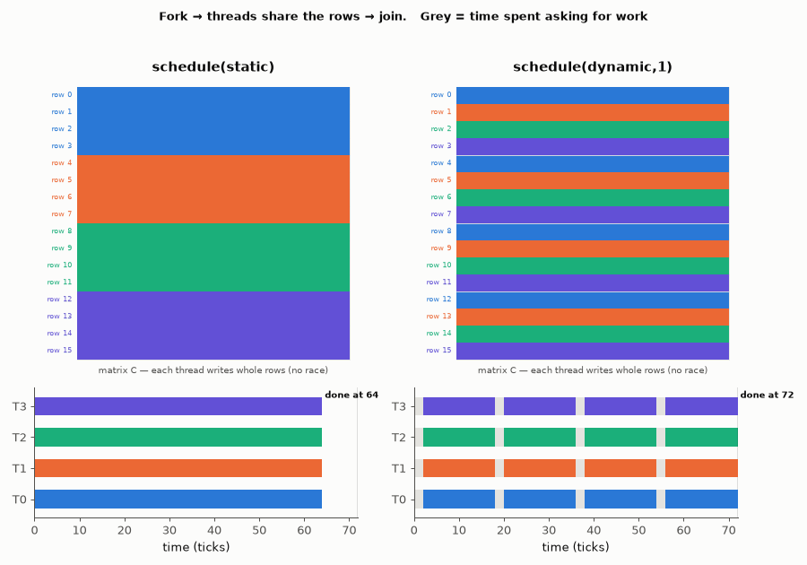
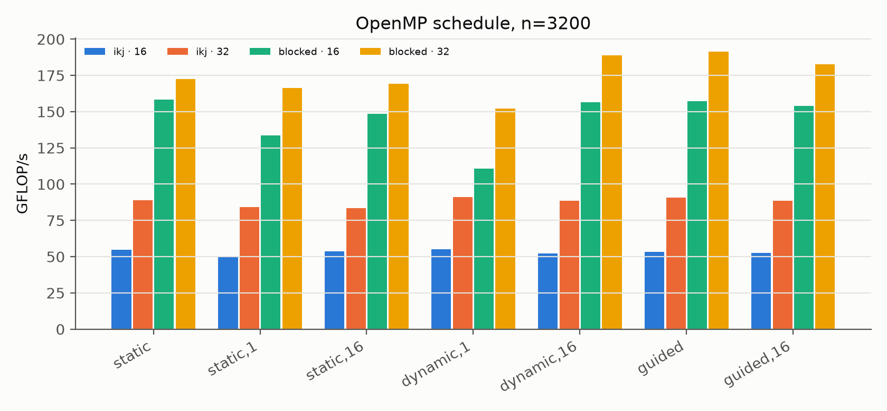
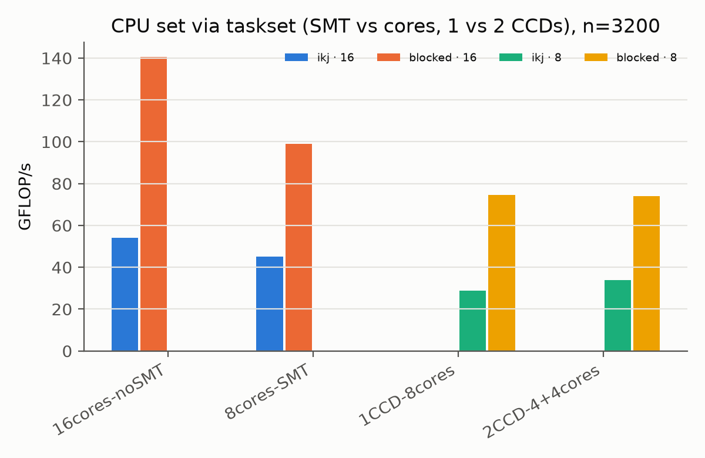
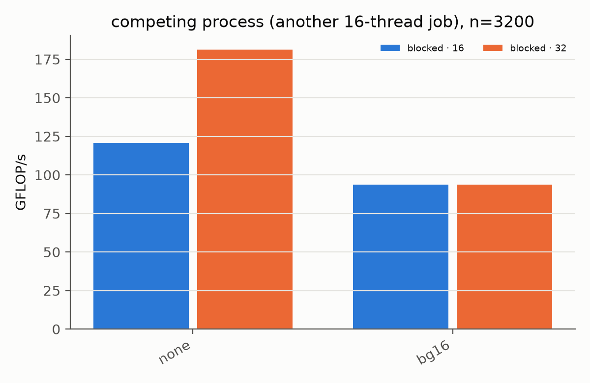
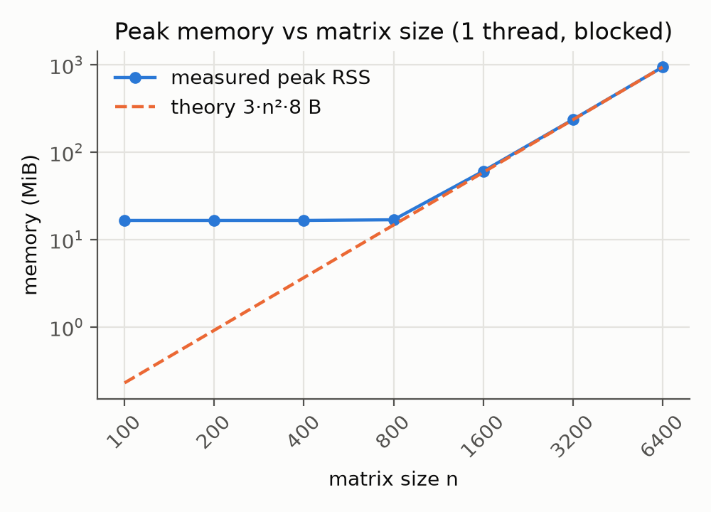
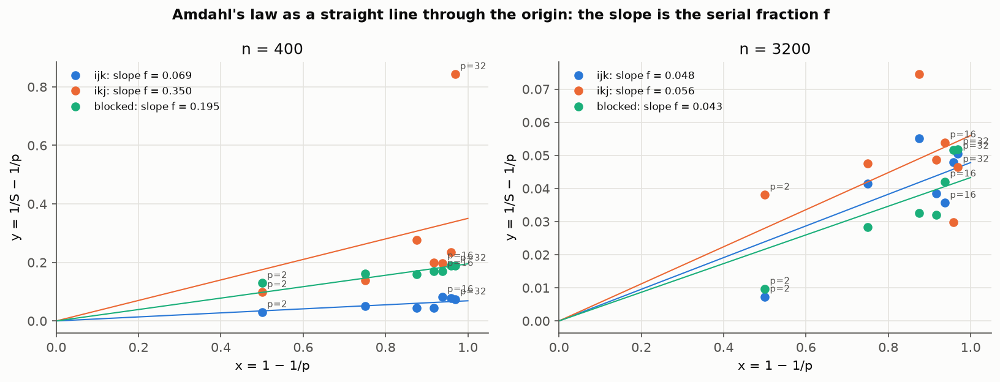
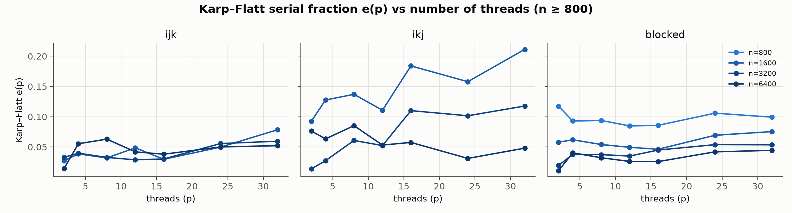
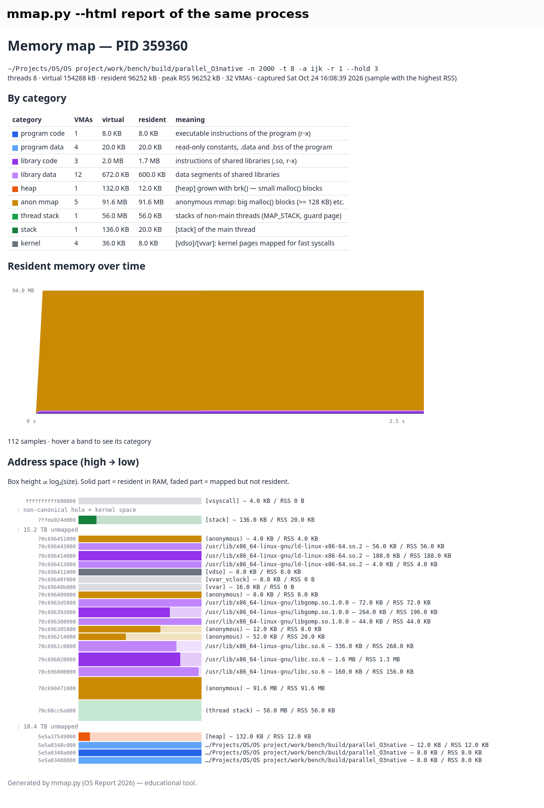

# บทนำ {#sec:intro}

รายงานฉบับนี้เป็นการศึกษาผลของการออกแบบโปรแกรมคำนวนเมทริกด้วยการทำ parallel โดยมีเป้าหมายเพื่อตอบคำถามหลัก 3 ข้อได้แก่ผลของการเลือกใช้ algorithm ในการแคชข้อมูลเพื่อทำการคูณเมตริก โดยดูที่ผลต่างความเร็วผลลัพท์ กระบวนการ และสาเหตุของความแตกต่างที่เกิดขึ้น ผลและประสิทธิภาพของการเพิ่มเธรดในการประมวลผลคำตอบ ว่าการเพิ่มเธรดให้มีจำนวนมากขึ้นจะสามารถเพิ่มความเร็วการประมวลผลได้อย่างไม่มีขีดจำกัดจริงหรือไม่ และกระบวนการจองหน่วยความจำ stack ของระบบและ RAM ว่ามีขนาดเท่ากันเสนอหรือไม่เพราะอะไร

# สภาพแวดล้อมการทดลอง {#sec:env}

การทดลองนี้จัดทำขึ้นบนคอมพิวเตอร์ส่วนตัว(AMD Ryzen 9 8945HX 16 core / 32 thread 2 CCD) หน่วยความจำ 30 GB บนระบบปฏิบัติการ Ubuntu 26.04.1 LTS ตั้ง CPU gvernor เป็น performance เสียบสายชาร์จตลิดการทดลอง [@amd8945hx]

\needspace{25\baselineskip}

| รายการ         | ค่า                                                                                                    |
| -------------- | ------------------------------------------------------------------------------------------------------ |
| CPU            | AMD Ryzen 9 8945HX · 16 core / 32 thread · 2 CCD                                                       |
| Cache          | L1d 32 KB/core · L2 1 MB/core · L3 32 MB/CCD (รวม 64 MB)                                               |
| RAM            | 30 GB                                                                                                  |
| OS / kernel    | Ubuntu 26.04.1 LTS · Linux 7.0.0-38-generic                                                            |
| Compiler       | gcc 15.2.0 (`-O3 -march=native -fopenmp`) · OpenMP runtime = libgomp                                   |
| glibc / Python | 2.43 / 3.14.4                                                                                          |
| การตั้งค่า     | governor = performance · boost = on · power profile = performance · เสียบไฟ AC · `ulimit -s` = 8192 KB |
| ผัง CPU        | CPU 0–15 = core จริง 0–15 · CPU 16–31 = SMT sibling · core 0–7 = CCD0, 8–15 = CCD1                     |

: {#tab:env}

{#fig:cache width=90%}

# อัลกอริทึมและการออกแบบโปรแกรม {#sec:design}

## การเก็บเมทริกซ์ในหน่วยความจำ {#sec:rowmajor}

เพื่อที่จะจัดการเมทริกซ์ในหน่วยความจำได้นั้นจะใช้การหั่นเมทริกซ์ออกมาเป็นแถวทีละแถวเพราะหน่วยความจำมีรูปแบบเป็นลิสต์แถวเดียว 1 มิติจะได้ว่าตำแหน่งของเมทริงหลังหั่นทีละแถวจะหาได้จากสูตร "y*n+x"  เมื่อกำหนดให้ y คือเลขแถว และ  x คือเลขคอลัมม์ในเมทริกซ์ และ n เป็นมิติ(แนวนอน) ของเมทริกซ์ และหน่วยความจำจะเก็บแคชเมตริกซ์นี้ไว้ครั้ง 64 B ต่อ line [@silberschatz2018]

{#fig:rowmajor width=95%}

## อัลกอริทึมสามแบบ {#sec:algos}

ในการคำนวนผลคูณเมตริกซ์ใช้การคูณแถวเข้ากับคอลัมม์เพื่อให้ได้ผลลัพท์ 1 ช่องนั้นคือมีงานคำนวน 2n และเพื่อให้ได้ครบทุกช่อง n^2 ช่องจะได้ว่ามีงานคำนวน 2*n^3 โดยอัลกอลิทึมที่จะใช้ในการทดลองนี้เลือกมา 3 แบบที่ใช้งานการทำนวนวิธีเดียวกันแต่มีลำดับการเข้าถึงหน่วยความจำไม่เหมือนกันโดยวิธีแรกคือแบบ ijk เป็นการเข้าถึงหน่วยความจำแบบเลือกลงตามคอลลัมม์ได้เมตริกลงมาแต่เนื่องจากหน่วยความจำใช้การเก็บเมตริกแบบตามแถวทำให้ต้องมีการจักดการหน่วยความจำใหม่ทุกครั้งที่มรการเปลี่ยนแถว วิธี ikj เป็นการเข้าถึงหน่วยความจำแบบทีละแถวเข้ากับวิธีที่หน่วยความจำจัดการกับเมตริกมากกว่าทำให้ไม่ต้องมีการจัดการหน่วยความจำเท่าแบบที่แล้ว และวิธีสุดท้ายคือแบบ tile ที่จะแบ่งเมตริกเป็นกระดาน 4 เหลี่ยนม 4 ชิ้นเท่ากันแล้วใช้การคำนวนผลคูณโดยการเลื่อนกระดานไปทีละส่วนจนครบเพื่อหาผลลัพท์ทีละส่วนและนำมาประกอบกันเป็นผลคูณ [@lam1991; @goto2008]

{#fig:cachesim width=95%}

{#fig:blocked width=95%}

## การทำให้ขนานด้วย OpenMP {#sec:openmp}

การทำให้ขนานจากภาพการแบ่งพิกเซลลให้แต่ละเธรดจัดการอาจทำให้เกิด race condition ได้จึงใช้วิธีแบ่งตามแถวให้แต่ละเธรดมีพื้นที่ของตัวเองซึ่งระบบมีรูปแบบการแบ่งมาให้ 2 แบบคือ static กับ dynamic โดย static เป็นการแบ่งโดยกำหนดแถวที่แน่นอนให้เธรดตั้งแต่เริ่มต้น และแบบ dynamic ที่มีการแบ่งแถวให้แต่ละเธรดตามความต้องการเมื่อเวลาผ่านไป ในการทดลองนี้เลือกใช้แบบ static เพราะมี overhead น้อยกว่าแบบ dynamic ที่ต้องตรวจสอบและคำนวนการแบ่งแถวในเธรด [@openmp52; @libgomp]

{#fig:omp width=90%}

## การแบ่งเฟสและการจับเวลา {#sec:phases}

การจับเวลาในการทดลองนี้แบ่งเป็น 3 ช่วงคือช่วง init เป็นการคำนวนแบบ serial ช่วง multiply เป็นการคำนวนแบบ parallel ที่เพื่อให้ค่ามีความน่าเชื่อถือจะมีการทำซ้ำหลายครั้งก่อนใช้ค่า median แสดงผล และช่วง verify ที่คำนวนแบบ serial

## ความปลอดภัยต่อระบบ (DO NO HARM) {#sec:safety1}

เพื่อความปลอดภัยจะมีการจำกัดขนาดเมตริก n <= 20000 และจำนวนเธรดน้อยกว่า CPU ตรวจว่า MemAvailable ก่อนจองไม่เกินครึ่งหนึ่ง ไม่ใช้ root และมีการตั้งค่า OS ดังที่แสดงให้ดูเพื่อการทำซ้ำการทดลอง ทดสอบ guard แล้วว่าป้องกันตามเงื่อนไขได้จริง

\needspace{23\baselineskip}

# วิธีการทดลอง {#sec:method}

| ชุด      | ตัวแปรต้น                                                                               | จำนวนรัน |
| ------------ | ------------------------------------------------------------------------------- | ------------ |
| scaling  | threads {1,2,4,8,12,16,24,32} × n {100 - 3200} × {ijk, ikj, blocked} (+ n=6400 blocked) | 152      |
| block    | tile b = 8…512                                                                          | 40       |
| schedule | `OMP_SCHEDULE` 7 แบบ                                                                    | 84       |
| compiler | `-O0 … -O3 -march=native`                                                               | 30       |
| os       | affinity · taskset (SMT/CCD) · `OMP_STACKSIZE` · โปรเซสแย่ง · power profile             | 57       |

: {#tab:experiments}

ตัวแปรในการทดลองนี้มีตัวแปรต้นตามที่กำหนดไว้ในตามตารางข้างบน(ตาราง 2)โดยแบ่งตัวแปรออกเป็น 5 ชุดโดยในการทดลองแต่ละชุดจะกำหนดให้ชุดตัวแปรที่สนใจเป็นตัวแปรต้น แล้วตัวแปรที่เหลือจะเป็นตัวแปรควบคุม โดยตัวแปรควบคุมนอกจากนี้ยังมี เครื่องคอมพิวเตอร์ที่ใช้ในการทดลอง seed และสภาพการทดลองตามตารางที่ 1 ผลที่ได้จะมีการวัดซ้ำ 5 รอบและเสนอค่า median ที่ได้เป็นผลการทดลองเพราะค่า median จะสะท้อนค่าที่คาดหวังจริงของการทำงานได้ดีกว่าค่ากลางอื่นๆ ในการทดลองนี้ ตัวแปรตามที่สนใจในการทดลองนี้คือเวลาการคำนวนของทั้ง 3 ช่วง GFLOP/s peak RSS VMpeak และอุณหภูมิ

# ผลการทดลองและการวิเคราะห์ {#sec:results}

## ผลของจำนวน thread {#sec:threads}

จากรูปที่ 7 จะเห็นว่าหลังจากมีการคำนวนที่ 16 เธรดแล้วความเร็วการคำนวนเพิ่มในระดับที่ความชันลดลงอย่างเห็นได้ชัด ต่างจากช่วงแรกที่เพิ่มเธรดจนถึง 15 เธรดที่ความเร็วการคำนวนมีค่าเพิ่มอย่างเห็นได้ชัด ซึ่งผลการทดลองที่ได้นี้เป็นไปตาม Amdaul rule คือการเพิ่มเธรดเพื่อเพิ่มความเร็วการคำนวนแบบ parallel จะไม่สามารถเพิ่มความเร็วการคำนวนทั้งระบบได้อย่างไม่มีขีดจำกัน เพราะเมื่อถึงจุดหนึ่งเวลาที่ใช้ในการคำนวนแบบ serial จะเข้ามามีอิทธิพลการเวลาคำนวนทั้งหมดแทนดังสมการ Speedup = 1/(s + (1−s)/p) [@amdahl1967] ซึ่งการหาผลของ serial นี้ว่ามีอิทธิพลจริงหรือไม่ แค่ไหนจะทำในเรื่องถัดไป

\needspace{17\baselineskip}

| n | ijk S(16) / S(32) | ikj S(16) / S(32) | blocked S(16) / S(32) | blocked E(16) |
|---|---|---|---|---|
| 100 | 3.55 / **0.09** | 1.47 / 1.27 | 1.07 / 1.19 | 0.07 |
| 800 | 11.07 / 9.33 | 4.26 / 4.24 | 7.00 / 7.85 | 0.44 |
| 3200 | 10.19 / 12.23 | 8.59 / 12.86 | 9.56 / 12.03 | 0.60 |
| 6400 | – | – | 11.54 / **13.47** | 0.72 |

: {#tab:threads}

{#fig:time width=100%}

{#fig:speedup width=100%}

{#fig:efficiency width=100%}

## ผลของขนาดเมทริกซ์ {#sec:size}

จากการวัดผล GFLOP/s ในการทดลองนี้จะเห็นว่าในรูปแบบการเข้าถึงหน่วยความจำทั้ง 3 รูปแบบนี้ให้ผลความเร็วการคำนวนที่ต่างกันอยู่โดยความแตกต่างนี้อาจจะมองเห็นได้ไม่ชัดเจนในการคำนวนด้วย 1 เธรดแต่ความแตกต่างจะชัดเจนขึ้นเมื่อมีการเพิ่มเธรดให้มากขึ้น(จากรูปแสดงผลของ 16 เธรด) จะเห็นได้ว่าวิธีแบบ ijk ช้าที่สุดเนื่องจากวิธีการเข้าถึงหน่วยความจำที่เสียเปล่าและไม่เข้ากับการจัดการหน่วยความจำของเมตริกซ์ แต่จุดที่น่าสนใจคือวิธี ikj และวิธี blocked โดยจะเห็นได้ว่าวิธี ikj มีความเร็วกว่าเมื่อคำนวนเมตริกขนาดน้อยกว่า 800 แต่ช้ากว่าเมื่อเมตริกมีขนาดเพิ่มขึ้นหลังจากนั้น โดยสาเหตุที่เป็นแบบนี้อาจเกิดจากเมื่อเมตตริกมีขนาดใหญ่ขึ้นเรื่อยๆ ก็ยิ่งทำให้การเข้าถึงหน้วยความจำต้องเข้าถึงชั้นลึกมากขึ้น ซึ่งวิธีเข้าถึงแบบรายแถวที่จากแต่เดิม 1 แถวสามารถแคชอยู่ในหน่วยความจำชิ้นเดียวได้อาจทำแบบเดิมไม่ได้และต้องเข้าหน่วยความจำหลายครั้งเพื่อให้คำนวนได้ กลับกันวิธี blocked ที่เก็บเมตริกแบบ tile อาจมีความทนทานต่อการเข้าถึงหน่วยความจำหลายครั้งมากกว่าเนื่อจากวิธีที่เก็บเมตริกซ์มรการเข้าถึงหน่วยความจำหลายครั้งอยู่แล้วแต่มีการเปลี่ยนแคชน้อยครั้งกว่าจึงทำให้ความเร็วไม่ลดลงเหมือนวิธีอื่นๆ [@lam1991]

\needspace{15\baselineskip}

| GFLOP/s, 1 thread | n=100 | n=400 | n=800 | n=1600 | n=3200 | n=6400 |
|---|---|---|---|---|---|---|
| ijk | 4.7 | 3.6 | 3.4 | 2.7 | **1.1** | – |
| ikj | 19.4 | 17.9 | 18.3 | 15.4 | **5.8** | – |
| blocked | 18.3 | 12.5 | 11.8 | 11.8 | 12.0 | 11.9 |

: {#tab:gflops}

{#fig:gflops width=100%}

## ผลของการตั้งค่าโปรแกรม {#sec:progsettings}

ในส่วนการทดลองการตั้งค่าโปรแกรมต่าง ๆ โดยการทดลองนี้กำหนดตัวแปรควบคุมเป็นวิธีการเข้าถึงข้อมูลใช้วิธี blocked

โดยทำการทดลองปรับขนาด tile เห็นผลดังรูปที่ 10 คือ tile ขนาด 8 แย่ที่สุด ขนาด 192-256 ดีที่สุด เนื่องจาก tile ขนาดที่เล็กเกินไปทำให้ต้องเลื่อน tile หลายครั้งกว่าที่จะให้ผลคูณเมตริกที่สมบูรณ์กลับมาได้

ทำการทดลองปรับ OpenMP schedule ได้ผลว่าที่ n ขนาดเล็ก(n=400) ค่า GF/s ที่ได้จากวิธีตั้งต่าง ๆ จะมีแนวโน้มที่ไม่เกาะกลุ่มหรือเรียงลำดับแบบเดียวกันเช่น n=400 blocked + (static,guided),16 ได้ 30 GF/s ซึ่งต่าจากอันอื่นที่ n เดียวกันที่จะอยู่ประมาณเกิน 100 GF/s ในขณะที่ n=3200 GF/s ที่ได้ขากวิธีต่างๆ จะเกาะกลุ่มและเรียงลำดับเดียวกันในทุกการตั้งค่า จึงอาจสรุปได้ว่าการตั้งค่ามีอิทธิพลต่อความเร็วการคำนวนน้อยลงที่ n มีขนาดมากขึ้น

\needspace{17\baselineskip}

| เทียบ                    | เวลา   |
| ------------------------ | ------ |
| n=3200 ijk 16 thread     | 5.53 s |
| n=3200 blocked 1 thread  | 5.47 s |
| n=3200 ijk 32 thread     | 4.58 s |
| n=3200 blocked 32 thread | 0.35 s |

: {#tab:compare}

และจากตารางจะเห็นว่าที่ n=3200 ijk 16 thread ใช้เวลา 5.53 วินาทีแต่ที่ n=3200 blocked 1 thread ใช้เวลา 5.47 วินาทีจะเห็นว่าวิธีการเข้าถึงหน่วยความทรงจำมีอิทธิพลต่อความเร็วมากกว่าจำนวนเธรดเห็นได้จากวิธี ijk ที่ 16 นั้นช้ากว่าวิธี blocked ที่ 1 เธรด

{#fig:block width=75%}

{#fig:sched400 width=80%}

{#fig:sched3200 width=80%}

## ผลของการตั้งค่าระบบปฏิบัติการ {#sec:ossettings}

ผลการทดลองการตั้งค่า OS เทียบ Core กับ SMT ตามรูป 13-14 การใช้ 16 คอร์เร็วกว่า 8 คอร์ + SMTอย่างชัดเจนเนื่องจาก  SMT ต้องแย่งทรัพยากรกับคอร์ที่ใช้ร่วมกัน และการปล่อยให้ OS scheduler กระจายงานเองนั้นให้ผลที่ดีกว่าการปักหมุดเธรดตายตัว

วิธี ikj บน 2 CCD ทำความเร็วได้ 33.9 GF/s  ซึ่งเร็ซกว่า 1 CCD ที่ได้ 28.9 GF/s เพราะได้พื้นที่ L3 ช่วยลดคอขวดแบนวิดท์หน่วยความจำที่ให้ผลดีกว่า overhead จากกวารข้าม CCD

ผลจากการแย่งทรับยากรทำให้ CPU ประสิทธิภาพลดลงเกือบครึ่ง(รูปที่ 15) ซึ่งอาจจะเกิดจาก Context switch ที่ OS ต้องเสียเวลาไปกับการสลับการทำงาน [@silberschatz2018]

power profile ส่งผลต่อความเร็วการคำนวนจริงคาดว่ามาจากการที่ OS ลดความถี่นาฬิกาลงทำให้การคำนวช้าลงตามแต่ละโหมด

อย่างไรก็ตามการทดลองนี้ทดสอบบนคอมพิวเตอร์ที่เปิด browser, VS code ไว้เบื้อหลังจึงอาจทำให้ผลที่ได้ได้รับผลกระทบไปด้วย ไม่ได้แสดงผลจริงสัมบูรณ์

\needspace{21\baselineskip}

| การทดลอง (n=3200) | GFLOP/s |
|---|---|
| taskset 16 thr: **16 core จริง** vs **8 core × 2 SMT** | blocked **140.5 vs 98.9** · ikj 54.2 vs 45.0 |
| `OMP_PLACES=threads` + `close` (16 thr) | blocked **100.7** (≈ 8 core × SMT 98.9) vs default 137.7 |
| ikj 16 → 32 thr (static) | 54.7 → **88.8** |
| 1 CCD (8 core) vs 2 CCD (4+4) | blocked 74.6 vs 74.1 · ikj 28.9 vs **33.9** |
| มีโปรเซส 16 thread แย่ง | 32 thr: **181.4 → 93.7** · 16 thr: 120.9 → 93.6 |
| power profile performance / balanced / power-saver | blocked 1 thr: 11.9 / 11.9 / **5.9** · 16 thr: 156 / 140 / **86** |

: {#tab:os}

{#fig:taskset width=75%}

{#fig:bind width=85%}

{#fig:contention width=65%}

{#fig:power width=75%}

## การใช้หน่วยความจำ {#sec:memory}

การใช้ Physical Memory ตรงตามทฤษฎี (3n²·8 B) เช่น n=3200 คำนวนได้ 234.4 MiB วัดได้ 235.9 MiB และ n=6400 คำนวนได้  937.5 MiB วัดได้ 939.5 MiB

VmPeak ขยายขนาดขึ้นตามเธรด แต่ RSS คงที่ ดูที่ n=1600 เมื่อเพิ่มจาก 1 เป็น 32 เธรด VmPeak จะเพิ่มจาก 62 เป็น 310 MiB แต่ RSS คงที่ประมาณ 61 MiB

การปรับขนาด Stack เป็น 1M, 8M และ 64M ทำให้ VmPeak เปลี่ยนเป็น 93, 310 และ 2046 MiB ตามลำดับ แต่ RSS คงที่ราว 61 MiB และไม่กระทบความเร็ว

ซึ่งผลที่ได้สามารถอธิบายได้จากการทำ Demand Paging ที่ OS จาก VM ก่อนที่จะจัดสรรให้ RAM จริง [@silberschatz2018]

{#fig:memn width=65%}

{#fig:memthreads width=65%}

## กฎของ Amdahl: สัดส่วน serial กับ parallel {#sec:amdahl}

จากการวิเคราะห์หาสัดส่วนการทำงานแบบ Serial(s) ด้วยสมการ S(p)= 1/(s + (1−s)/p) [@amdahl1967] เพื่อหาเพดานความเร็วสูงสุดโดยการทำ Least Squares Regression เพื่อหาความชัน(ffit)ได้ผลลัพท์ตามตารางที่ 7 และรูปที่ 19-20

เทียบ ffit กับ fmeas ที่ n เล็กค่าทั้งสองจะใกล้เคียงกันแต่เมื่อขยาย n ขึ้นค่าเช่นที่ blocked n=6400 จะได้ ffit = 0.029 ได้เพดานความเร็วเป็น 35 เท่า แต่ fmeas ได้ 0.010 ความต่างนี้น่าจะมาจาก overhead จาก SMT อุณหภูมิหรือหน่วยความจำ

จากการคำนวน e(p) จะทำให้เห็นชัดขึ้นว่ามี overhead จริงเพราะ e(p) ไม่คงที่และโตตาม p ทำให้เห็นว่ายิ่งเธรดมาก overhead ของการทำ parallel ก็ยิ่งมากตาม [@karp1990]

\needspace{23\baselineskip}

| algo | n | $f_\text{fit}$ (p ≤ 16) | $f_\text{meas}$ | $S_\text{max}$ (p) | $1/f$ | R² |
|---|---|---|---|---|---|---|
| ijk | 100 | 0.240 | 0.232 | 3.6 (16) | 4.2 | – |
| ijk | 3200 | 0.046 | 0.002 | 12.2 (32) | 22 | 0.98 |
| ikj | 3200 | 0.065 | 0.010 | 14.0 (24) | 15 | 0.89 |
| blocked | 200 | 0.358 | 0.259 | 2.6 (24) | 2.8 | 0.81 |
| blocked | 1600 | 0.052 | 0.038 | 9.6 (32) | 19 | 0.92 |
| blocked | 3200 | 0.038 | 0.020 | 12.0 (32) | 27 | 0.94 |
| blocked | 6400 | 0.029 | 0.010 | 13.5 (32) | 35 | 0.94 |

: {#tab:amdahl}

{#fig:amdahlfit width=100%}

{#fig:karpflatt width=100%}

## ข้อจำกัดของการทดลอง {#sec:limits}

การทดลองนี้ใช้โหลดหนักอย่างต่อเนื่องทำให้มีช่วงที่อุณหภูมิ CPU สูงถึง 98-100 องศาเซลเซียสซึ่งทำให้ระบบลดความถี่สัญญาณนาฬิกาลงเพื่อป้องกันความเสียหาย

คอมพิวเตอร์เปิดใช้งานโปรแกรมอื่นอยู่เบื้อหลังอาจทำให้เกิดการแย่งใช้งาน CPU หรือหน่วยความจำในบางจังหวะ

ในเมทริกขนาดเล็กเวลาการคำนวนจะเร็วมากทำให้ความผันผวนจาก overhead ส่งอิทธิพลอย่างมากต่อผลการทดลองได้

# เครื่องมือแสดงแผนที่หน่วยความจำ {#sec:mmap}

## แนวคิดและแหล่งข้อมูล {#sec:proc}

เครื่องมือนี้ใช้ข้อมูลจากระบบไฟล์ /proc ซึ่งเป็นอินเทอเฟซที่ linux ใช้เปิดข้อมูลสถานะของ process โดยมี VMA (Virtual Memory Area) คือบล็อกของหน่วยความจำเสมือนที่จองไว้เป็นช่วงต่อเนื่องกันและมีสิทธิ์การเข้าถึง เดียวกัน `/proc/<pid>/maps` แต่ละบรรทัดจะบอกข้อมูล 1 VMA ประกอบด้วยช่วง Address, สิทธิ์ (rwxp) และชื่อไฟล์ที่ถูกแมป `/proc/<pid>/smaps` และอื่นๆ ใช้สำหรับดูสถานะอื่นๆ ข้อจำกัดของระบบ และชี้ไปยังไฟล์รันไทม์ตามลำดับ [@kernelproc; @man_proc_pid_maps; @man_proc_pid_smaps]

เลือกใช้วิธีดึงข้อมูลสถานะจาก OS โดยตรง เพราะสามารถแสดงภาพหน่วยความจำขณะโปรแกรมทำงานได้จริงแบบเรียลไทม์ เห็นผลของ Demand Paging และมี Overhead ต่ำกว่าวิธีอื่น

## การออกแบบและการพัฒนา {#sec:mmapdesign}

การทำงานของเครื่องมือถูกแบ่งเป็น 5 ขั้นตอน คือการอ่านข้อมูลสถานะแบบเรียลไทม์จากระบบ การแยก VMA การจัดหมวดหมู่ VMA การรวมข้อมูลบล็อกประเภทเดียวกัน และการแสดงผลออกทางหน้าจอ

กลไกในขั้นตอนการจัดหมวดหมู่ VMA ใช้การออกแบบเป็น Decision tree

1. ตรวจสอบ path แล้วจัดหมวดหมู่ตามนั้น  heap, stack และ kernel
2. กรณีไม่มีชื่อ จะพิจารณาจากสิทธิ์การเข้าถึงและ flag
3. กรณีมีไฟล์แมปอยู่ จะตรวจว่าเป็นไฟล์รันไทม์หรือไม่(ใช่จัดเป็น program code/data) หากไม่ใช่จะดูว่าเป็น `.so` หรือไม่ (ถ้าใช่จัดเป็น `library code/data`) ส่วนไฟล์ที่เหลือทั้งหมดจะตกไปอยู่ในหมวด `mapped file` ทั่วไป

\needspace{27\baselineskip}

## ความสามารถและวิธีใช้งาน {#sec:mmapusage}

| คำสั่ง | ผลลัพธ์ |
|---|---|
| `python3 mmap.py PID` | snapshot: summary + address-space layout |
| `python3 mmap.py PID --all` | also list every region (no merging of segments) |
| `python3 mmap.py PID --watch` | real-time view, refresh every `--interval` seconds |
| `python3 mmap.py PID --html out.html` | write a self-contained HTML/SVG report |
| `python3 mmap.py --run -- CMD [ARGS...]` | start CMD, watch it until it exits, then report |
| `python3 mmap.py --self` | inspect this Python process itself (demo) |
| `python3 mmap.py --list` | list your own processes |

: {#tab:mmapcmd}

ตารางที่ 8 สรุปคำสั่งการใช้งานทั้งหมดของเครื่องมือเมื่อเรียกคำสั่งเหล่านี้ จะได้ผลลัพธ์การวิเคราะห์หน่วยความจำตามโหมดที่เลือก

รูปที่ 21 และรูปที่ 22 แสดงภาพหน้าจอจริงขณะใช้งานใน Terminal และผลลัพธ์รูปแบบ HTML โดยอ่านโดย สัญลักษณ์ทึบ แทน RSS สัญลักษณ์จาง แทนพื้นที่ที่ระบบจองไว้แต่ยังไม่ถูกใช้งาน, และสัญลักษณ์จุดแนวตั้ง แทนช่องว่างในหน่วยความจำ

{#fig:terminal width=100%}

{#fig:html width=80%}

## ตัวอย่างการใช้งานกับโปรแกรมข้อ 1 {#sec:mmapdemo}

ทดลองใช้เครื่องมือดูการทำงานของโปรแกรมคูณเมตริกซ์ในข้อ 1 ได้ผลเป็นพฤติกรรมการทำงาานของโปรแกรมโดยเริ่มจาก OS โหลด executable code จากไลบารี C เข้าหน่วยความจำจากนั้นเมื่อโปรแกรมจองพื้นที่เมตริกซ์จะเห็น anonymous mmap สูงขึ้นจามด้วย thread stack ขณธประมวลผลแบบ parallel และส่งคืนหมดเมื่อจบการทำงาน โดยในตอนที่ทำ parallel พบ  stack รวมสูงถึง 56 MB แต่กลับมี RSS จริงเพียง 56 KB ซึ่งน่าจะเกิดจากการทำ demand paging [@silberschatz2018]

{#fig:mmaprun width=100%}

## ความปลอดภัยและข้อจำกัด {#sec:safety2}

เครื่องมือใช้วิธีการอ่านข้อมูลอย่างเดียว ไม่มีการใช้สิทธิ์ root ในการแทรกแทรงโปรเซสสามารถดูได้เฉพาะโปรเซสที่เป็นสิทธิ์ของผู้ใช้งานเองเท่านั้น ใช้ได้แค่กับ linux เท่านั้นเนื่องจากใช้งานจากใช้งานระบบไฟล์ /proc

# สรุป {#sec:conclusion}

จากการทดลองแสดงว่าวิธีการเข้าถึงหน่วยความทรงจำมีความสำคัญต่อประสิทธิภาพมากกว่าการเพิ่มเธรดเพียงอย่างเดียว และจากการประเมิณด้วย Amdahl rule พบสัดส่วนการทำงานแบบ serial ที่ประมาณ 0.03-0.05 ซึ่งค่าที่ได้นี้มีส่วนมาจาก overhead ของการทำ parallel ด้วยจึงไม่ใช้ส่วนของการทำ serial โดยสมบูรณ์ และเครื่องมือที่สร้างแผนที่หน่วยความทรงจำที่สร้างขึ้นสามารถติดตามหน่วยความจำขณะรันไทม์ได้

# การใช้ AI {#sec:ai}

ในการจัดทำโครงการทั้งหมดใช้เครื่องมือ AI ช่วยเหลือคือ AI coding assistant ใน VS Code เป็นหลักโดยงานที่ใช้เครื่องมือนี้ช่วยเหลือประกอบด้วย code (โปรแกรมการคูณ `mmap.py` ทั้งโปรแกรม รวมถึง `run_bench.py`, `analyze.py`, `check_submission.py` (สคริปต์ตรวจก่อนส่งงาน ไม่ได้ใส่ใน repo นี้), ระบบ build PDF และ outline ที่มีตัวเลขกับเช็กลิสต์) รวมถึงตอบคำถามข้อสงสัยของผู้จัดทำโครงการ ในรายงานเครื่องมือมีบทบาทเป็นผู้ตรวจสอบความถูกต้องข้อมูลและผู้จัดโครงร่างเอกสารเท่านั้น เนื้อหารายงานถูกเขียนโดยผู้จัดทำเอง

การตรวจสอบความถูกต้องของเครื่องมือผู้จัดทำตรวจสอบโดยการคำนวนย้อนกลับผลการทดลองเทียบกับทฤษฏีเพื่อดูความแตกต่าง

